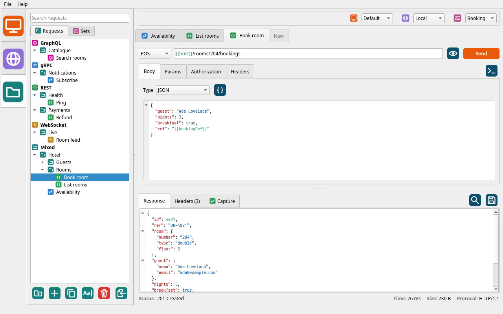

# TriggerAPI

A desktop client for making REST API, GraphQL and gRPC calls, calling the
tools of MCP servers and talking to WebSocket servers. It is written in Go
with a Qt 6 interface using the [miqt](https://github.com/mappu/miqt)
bindings.



## Why TriggerAPI

- **No account, no cloud.** There is nothing to sign in to and nothing is
  synchronised anywhere. TriggerAPI works the same with no network at all.
- **No telemetry.** The only requests it makes are the ones you send.
- **Your data is yours.** Requests, environments and settings are files in
  ordinary folders, which you can back up, copy to another machine or keep in
  a folder that is synced. See [Running](#running) for where they are.
- **Encrypted on disk.** Requests and environments hold tokens and passwords,
  so they are encrypted with your own SSH keys, and a workspace is shared by
  encrypting it for the other person's public key. There is no key of
  TriggerAPI's and no service in the middle. See [Encryption](#encryption).
- **Native.** It is a single compiled program with a Qt interface, not a web
  browser in a window, so it starts quickly and needs nothing else installed
  but Qt.
- **REST, GraphQL, gRPC, MCP and WebSocket together.** Every kind of request
  lives in the same folders and uses the same environments, and REST,
  GraphQL, gRPC and MCP requests capture values for each other.
- **A whole gRPC or MCP server as requests, in two clicks.** TriggerAPI asks
  the server what it has, lists every endpoint, and makes a saved request of
  each one you tick, in a folder for each gRPC service, or for the tools,
  resources and prompts of an MCP server. There are no protobuf files to find
  and nothing to type. When the server gains endpoints, open one of those
  requests and add the new ones to the same folders. See
  [Creating requests from a server](#creating-requests-from-a-server).
- **Nothing left unfilled by accident.** A `{{placeholder}}` the environment
  does not define, or defines as nothing, is red wherever it is used, in the
  cells of tables and the password of basic authorization too, before the
  request is sent.
- **Safe to share.** No request can make TriggerAPI start a program of its
  choosing. MCP servers are reached over HTTP only, never started as
  programs, so a workspace someone gives you does nothing until you send its
  requests yourself. See [MCP](#mcp).
- **Up to date with MCP.** It speaks the stateless protocol of MCP 2026-07-28,
  and still works with servers from before it, which use sessions.
- **The small things.** Right-click a value in a response to capture it into
  a variable. Keep sets of pinned tabs for each piece of work. JSON and
  GraphQL are coloured and foldable everywhere they are shown, and requests
  can be found and opened without touching the mouse.
- **Easy to move to.** Postman collections and environments, and OpenAPI and
  Swagger documents, are imported as folders of requests.
- **Free software.** It is licensed under the GPL, so it can be used, studied,
  changed and shared.

## Features

**REST**

- Send GET, POST, PUT, PATCH, DELETE, HEAD and OPTIONS requests with query
  params, headers, basic, bearer or [OAuth 2.0](#oauth-20) authorization,
  and a JSON, text, XML or form body.
- Params are shown in the URL and kept in step with it both ways. Params,
  headers and form fields can each be switched off without being removed.
- A long URL is wrapped, with the field growing to show all of it.
- Opening a request, or changing its method, shows the tab it is likely to
  need: the body for POST, PUT and PATCH, and the params for the rest.
- A Format button beside the type of a JSON body sets the JSON out, one value
  to a line, leaving any `{{placeholders}}` in it as they are.
- Preview the URL with the environment's variables filled in, in place of the
  URL field. Each value is coloured, and a placeholder with no value is
  marked.
- Show any request as a `curl` command, with the environment's variables
  filled in, to copy and run in a terminal, or run it from TriggerAPI with the
  installed `curl` and see the response as usual.
- Paste a `curl` command, such as one copied from a browser's developer
  tools, into the URL field of a new request that is not saved yet, and it
  becomes the request: its method, address, params, headers, authorization
  and body. The type of the body comes from its `Content-Type` header, which
  is then not listed with the headers if it is the one that type sends
  anyway, and a bearer `Authorization` header becomes the authorization.
  Options that only say how curl runs (`-s`, `-L`, `-o`, ...) are left out,
  and a command which sends a file or a multipart form is refused.
- A response of server-sent events (`Content-Type: text/event-stream`), as
  the APIs of language models stream their answers, is shown as it comes:
  each event with when it came, its type and its ID, followed as it grows.
  The bar beneath says whether the stream is open, has ended or was stopped,
  how many events there were and how long the first took. The time limit of
  the settings is on the headers alone, so a stream can stay open as long as
  the server keeps it; Cancel stops it, keeping what had come. Values are
  captured from the data of the last event, and Save writes the stream as it
  was received. GraphQL responses are shown the same way.

**gRPC**

- Call methods of every kind (unary, server streaming, client streaming and
  bidirectional), sending the message as JSON with metadata and basic,
  bearer or OAuth 2.0 authorization. A method that takes a stream of
  messages is given several, one after another or in an array, which are
  all sent before the server's answers are shown; the request says so
  beside the message, its example is two messages, and Format and completion
  work on each.
- The methods of a server are discovered using gRPC server reflection, so no
  protobuf files are needed, and an example message can be filled in for the
  method chosen.
- A Format button sets out the JSON of the message, as it does a REST body.
- The message is completed from the service definition as it is typed: the
  fields of the message the cursor is in (following nested messages, lists
  and maps), with their types, and the values of an enum or a boolean. Type
  a quote or a name to see them, or press Ctrl+Space.
- The Service Definitions tab lists the endpoints of the server under their
  services, each with a checkbox, and can be searched by the name of an
  endpoint or a service. Create Requests makes a folder of saved
  requests from those that are ticked, and Update Requests adds more to a
  folder made that way. See
  [Creating requests from a server](#creating-requests-from-a-server).

**GraphQL**

- Send a query or mutation to a GraphQL endpoint, with its variables as a
  JSON object, headers, and basic, bearer or OAuth 2.0 authorization. It is sent as a
  POST of JSON, with the time limit and redirect setting of a REST request.
- Placeholders can go anywhere in the query and the variables, including
  where a value goes without quotes, as in `{"id": {{id}}}`. A Format button
  sets out the variables.
- The query and the schema are syntax highlighted in the colours of JSON, and
  the variables as JSON, and all three can be folded.
- The query is completed from the schema of the server as it is typed: the
  fields of the type of the selection the cursor is in, with their types, the
  arguments of a field and the values of an enum or a boolean argument, the
  types a fragment can be on, directives, and the kinds of operation. The
  schema is asked for when the query is first given the keyboard. Type a
  name to see what there is, or press Ctrl+Space.
- The errors a GraphQL response reports are shown beneath it as its error,
  whatever its HTTP status.
- The Schema tab shows the schema of the server, in the schema definition
  language, asked for through introspection with the request's headers and
  authorization when the tab is shown, or when the query is given the
  keyboard to be completed; Reload asks again.

**MCP**

- Call the tools, read the resources and get the prompts of a
  [Model Context Protocol](https://modelcontextprotocol.io) server, over the
  Streamable HTTP transport, with headers and basic, bearer or OAuth 2.0 authorization.
  See [MCP](#mcp) for why local servers that only speak stdio need a bridge.
- What the server has is loaded when a request is opened, and offered under
  Tools, Resources and Prompts headings with what the server says of each.
  Use Example Arguments fills in arguments from the schema of a tool, and a
  Format button sets them out.
- The result is shown as JSON, with the server's name and the protocol
  version beneath. A tool that reports an error, or a JSON-RPC error, is
  shown as a failure.
- What the server sends while a call is under way is listed in the Events
  tab as it comes: its progress, which is also shown beneath the response,
  and the messages it logs, at every level.
- A server that asks the user for something (elicitation) has its form shown
  in a dialog, with a field for each value it asks for, to accept, decline
  or cancel. A server that asks for the message of a language model
  (sampling) has its messages shown in a dialog, in which the reply to give
  it is written by hand, or declined. What was asked, and how it was
  answered, is listed in the Events tab too. See [MCP](#mcp).
- The Capabilities tab makes a saved request of each tool, resource and
  prompt ticked, as the Service Definitions tab of a gRPC request does.

**WebSocket**

- Connect to a WebSocket server (`ws://` or `wss://`, which is assumed when
  there is no scheme), with headers and basic, bearer or OAuth 2.0 authorization on the
  handshake. The connection stays open until Disconnect is pressed, the
  server closes it or another request is shown.
- Send the message as often as wanted while connected, with Send or
  Ctrl+Return; Ctrl+Return connects first if need be. A message can be any
  text, and is coloured, foldable and formatted when it is JSON.
- Every message sent and received is listed beneath, in order, each with
  which way it went and when, and can be searched and saved to a file. The
  bar beneath says whether the connection is open, how many messages went
  each way and how long the handshake took, and how the server closed the
  connection, in red unless it closed normally. The headers of the server's
  answer to the handshake are in their own tab.

**Responses**

- How a request went is shown beneath its response: the status, any error,
  and the time it took, with the size and protocol of an HTTP response
  (and whether a stream of events is open, how many events there were and
  when the first came), the number of messages of a gRPC call, or the server
  and protocol version of an MCP call. Failures are in red. The headers of the response, and the
  trailers of a gRPC call, are in a tab of their own.
- The Timing tab of a REST or GraphQL response shows where the time went:
  the redirects, DNS lookup, TCP connect, TLS handshake, sending the request,
  waiting for the first byte of the response (mostly the server's own time)
  and downloading it, each with a bar on the time of the whole (in a colour
  of its own, chosen in the settings), and in a panel beneath, the server's
  address, whether the connection was new or reused, and the TLS version and
  cipher. A request run with curl gives the times curl measures;
  after a redirect, curl adds up the times of each request, so only the
  redirects, the wait and the download are shown.
- Capture values from a response into variables of the selected environment,
  such as a token from a login to use in later requests. The Capture tab of
  the response lists the variables to set, each with the path of its value in
  the JSON of the response, such as `data.items[0].id`, and optionally a
  regex to keep only part of that value: what the regex matches, or what its
  first group matches if it has one. A tick or a cross on the tab and against
  each variable shows whether it was captured.
- Right-click a value in a JSON response and choose Capture to add the
  variable for it, with its path filled in.
- Check that a response is what it should be with assertions, listed on the
  Assertions tab of the response of every REST, GraphQL, gRPC and MCP
  request and saved with it. Each row checks one thing: the status, the time
  in milliseconds, a header (named in the path column), a value in the body
  (by the same paths as captures; with no path, the whole body, as text if it
  is not JSON) or the size of the body in bytes. It compares it in one of
  these ways:
  - **equals** / **does not equal**: a number as a number, so `1` equals
    `1.0`; an object or array as JSON, so spacing does not matter; anything
    else as text, with `null` for null. The status is compared ignoring
    case, by any name it goes by: an HTTP status by its code (`200`) or its
    status line (`200 OK`), a gRPC status by its name (`NOT_FOUND`) or code
    (`5`), and an MCP call by its outcome (`OK`, `Tool error`, or the code
    and name of a JSON-RPC error).
  - **contains** / **does not contain**: text containing the value, or an
    array with an element equal to it.
  - **matches regex**.
  - **exists** / **does not exist**: the path or header is there, even if it
    is null.
  - **is less than** / **is greater than**: both are numbers.
  - **has length**: the elements of an array, the members of an object or the
    characters of a string.
  - **is empty**: an empty array, object or string, or null.

  `{{placeholders}}` in the value are replaced when the response comes, after
  any values have been captured from it. Every response is checked, an error
  status too, but nothing is when there is no response at all. A tick or a
  cross on the tab and against each row shows how it went, with why a check
  failed beside it, and the results are kept in the history. Right-click a
  value in a JSON response and choose Assert to add a check that it equals
  what it is.
- JSON bodies, messages, arguments and responses are syntax highlighted, and
  their objects and arrays can be folded.
- Find text in a response with Ctrl+F, or the button beside its tabs: every
  match is marked and counted, and Enter and Shift+Enter go from one to the
  next.
- Save the body of a response to a file. JSON is saved formatted. The name
  offered for the file is that of the request and the time, such as
  `book_room_20261011_173005_resp.json`, in lower case with underscores for
  anything that is not a letter or a digit. For a response opened from the
  history, they are the name of the request it was sent as and the time it
  was received.

**History**

- Every request sent is kept in the History tab of the sidebar, newest first
  under a heading for each day, with its time, its status (in red if it
  failed) and its name, or for a request that was not saved what it was sent
  to. A WebSocket connection is kept once it is closed, with the messages
  that went over it. A request that is cancelled is not kept.
- Each workspace has its own history, encrypted like its requests. What is
  kept is the request as it was written, with its `{{placeholders}}`, and
  where it went with them filled in; the values of the other placeholders,
  which are often secrets, are not kept.
- Select an entry to open a copy of its request, not saved, in the tab that
  is not pinned, with the response it was given. It can be sent again, or
  saved to the sidebar with Save. Changing the saved request it was sent from
  does not change the entry. Double-click an entry to open the saved request
  it was sent from instead, if it is still where it was.
- The days are folders, opened and closed by the arrow before each, by
  double-clicking the date, or by Left and Right on an entry. Each is open
  until it is closed, and a search opens them all.
- Each entry has a box to tick it, and the box of the heading of a day ticks
  every entry of that day, or unticks them if they all are. The remove button
  beneath removes the ticked entries, or the selected one if none is ticked.
  The history can be searched by name and address.
- Compare the responses of two or three ticked entries with a diff tool of
  your choosing, such as `meld` or `kdiff3`, with the compare button beside
  the remove button. The tool is set under History in File > Settings as a
  command, to which the files to compare are added, oldest first: each holds
  the body of a response as it is shown, or the error there was instead. The
  command is run as it is written, not by a shell, so quote a word with
  spaces in it. The files are written to a temporary folder that only you
  can read, and deleted when TriggerAPI closes.
- The settings say how many requests are kept (50 to begin with, and up to
  1000), or that none are. A response body larger than 1 MB is not kept,
  and the oldest entries are dropped to keep the bodies within 32 MB.
- The history is written to its file when the workspace is left and when
  TriggerAPI closes, not after every request, as the whole file is encrypted
  again each time it is written.

**Organising requests**

- Keep separate sets of environments and requests in workspaces, and switch
  between them.
- The workspace and the environment in use are shown above the request, in
  drop-downs which switch to another, and after them a Request Set drop-down
  which chooses a set of tabs, or None for no set. Before each is an icon
  button: that of the workspace shows the workspaces, that of the environment
  opens and closes the editor of the environment in use (showing the
  environments in the sidebar unless it is showing the requests, and not
  closing it while the environments are shown), and that of the set shows
  the sets.
- Save requests in folders, nested to any depth, and move them between
  folders by dragging. Folders and requests are listed alphabetically, and
  requests can be searched by name, showing only the folders that hold a
  request found. The top level folders are listed under GraphQL, gRPC, MCP,
  REST, WebSocket and Mixed headings by the requests they hold; this is
  worked out as they are shown and is not saved.
- Open a request without the mouse: Ctrl+P goes to the search, Return goes
  on to what was found, the arrow keys move through the folders and requests
  (left closes a folder and right opens one), and Return opens the request.
- Pin requests to keep them open in tabs. TriggerAPI always starts with one
  empty tab, and nothing selected. The tab that is not pinned has a pin button
  to pin it; a pinned tab shows the icon of its request's type, which turns
  into a bin while the pointer is over the tab; double-click the bin to unpin
  the tab (a single click does nothing, so a tab is not unpinned by accident).
  Drag the tabs into another order; the tab that is not pinned is pinned by
  being dragged. The last tab, New, drawn faded, opens a new REST, GraphQL,
  gRPC, MCP or WebSocket request without saving it; Save, shown beside Send,
  Invoke, Call or Connect only while the request is not saved, adds it to the
  sidebar, as does the add button of the sidebar.
- Save the pinned tabs as named sets, on the Sets tab beneath the search of
  the Requests tab. A set holds the pinned tabs, which can be requests from
  any folders; choosing another set replaces the tabs with its own, and
  pinning, unpinning and moving tabs changes the set chosen. Deselecting the
  set takes its tabs away and leaves one empty tab, which belongs to no set.
  Add a set to keep the tabs pinned now, and duplicate, rename or remove sets
  with the buttons beneath them. A request renamed or moved stays in its sets,
  and one that is removed is taken out of them. The set chosen in a workspace
  is chosen again when you go back to it, but not when TriggerAPI is next run.
- Duplicate a workspace, an environment, a request, or a folder with
  everything in it.
- Copy a request, a folder with everything in it, or an environment with
  Ctrl+C, and paste it with Ctrl+V, in the same workspace or another. A
  request or folder is pasted into the selected folder (or the folder of the
  selected request), or else at the top level; something given the name of
  another beside it has " copy" added. What is copied is kept by TriggerAPI
  itself and never put on the system clipboard, so the tokens and passwords
  in requests and environments do not leave it.
- Import an OpenAPI 3 or Swagger 2 document, as JSON or YAML, or a Postman
  collection, to create a folder of requests. Only requests with one of the
  methods above are imported; others, such as TRACE or PURGE, are left out.
  A Postman request with a GraphQL body is imported as a GraphQL request.
  OAuth 2.0 is imported with its token URL and the rest when it is by a
  grant TriggerAPI has, and as a `{{token}}` bearer token otherwise.

**Environments**

- Define environments of variables and use them anywhere in a request as
  `{{name}}` placeholders. Environments exported from Postman can be imported.
- Give each variable a description. Several variables can share a name, to
  keep the values it is switched between: switching one on switches the
  other off.
- Placeholders are coloured wherever they are used, the password of basic
  authorization included, which is shown as it is typed: green if the
  selected environment gives them a value, and red if it does not define
  them or defines them as nothing.
- Give a variable a function as its value to have the value generated for
  each request. See [Functions](#functions).

**Settings**

File > Settings has five tabs:

- Workspaces: the folder the workspaces are kept in, the SSH keys they are
  encrypted with (see [Encryption](#encryption)), and exporting and
  importing them (see [Sharing workspaces](#sharing-workspaces)).
- Requests: how long a request of any kind can take before it is given up
  on (for a stream of server-sent events, how long its headers can take),
  and whether a REST or GraphQL request follows redirects or shows the
  response that redirects.
- Network: how every kind of request reaches its server (see
  [Network](#network)).
- History: whether the requests sent are kept in the history, how many, and
  the diff tool responses are compared with.
- User interface: the font of code (request and response bodies, messages,
  queries, arguments and the curl command), and the colours of the
  interface, listed in sections: the icons of the sidebar and of each type of
  request, the buttons, the sets, the history, placeholders, errors, the marks of captures and assertions,
  the matches of a search, the bars of the Timing tab and JSON highlighting, which GraphQL is coloured
  with too.

The size and layout of the window are remembered between runs. Folders of
requests all start closed; choosing a request's tab opens the folders it is
in.

## Functions

A variable whose value is one of these functions, and nothing else, is given a
freshly generated value each time a request is sent. Within one request the
value is the same everywhere the variable is used.

| Value | Generates | Example |
|---|---|---|
| `random_uuid()` | A random UUID | `3f2b8c1e-9a4d-4e7b-b1c6-5d8e2f0a7c94` |
| `random_int()` | A random whole number from 0 to 1000 | `417` |
| `random_int(10)` | A random whole number from 0 to that number | `7` |
| `random_int(5, 9)` | A random whole number from the first number to the second | `6` |
| `iso_date()` | Today's date | `2026-10-11` |
| `iso_date(1)` | The date that many days from today | `2026-10-12` |
| `iso_timestamp()` | The time now, in UTC | `2026-10-11T15:04:05Z` |
| `iso_timestamp(2)` | The same time that many days from now | `2026-10-13T15:04:05Z` |
| `unix_timestamp()` | The time now, in seconds since 1970 | `1791731045` |
| `unix_timestamp(2)` | The same time that many days from now | `1791903845` |
| `base64(text)` | The text in base64 | `base64({{user}}:{{password}})` gives `YW5uOnNlY3JldA==` |
| `sha256(text)` | The SHA-256 hash of the text, in lower case hex | `sha256(abc)` gives `ba7816bf…20015ad` |

The number of days can be negative, so `iso_date(-1)` is yesterday. Dates are
in the local time zone and timestamps in UTC. Both ends of the range of
`random_int` are included.

The text of `base64` and `sha256` is everything between the brackets, as it is
written, spaces included. Placeholders in it are replaced with the other
variables of the environment, including ones that are themselves functions,
so a variable `signature` set to `sha256({{request_id}}{{secret}})` hashes the
same UUID that `{{request_id}}` puts in the request. A variable whose text
needs its own value, directly or through others, keeps that placeholder as it
is. The value of a variable that is not a function is used as it is written,
placeholders and all.

For example, with a variable `request_id` set to `random_uuid()`, a header of
`X-Request-Id: {{request_id}}` carries a new UUID on every request.

A function is only recognised when it is the whole value: `id-random_uuid()`
is used as it is written. To put a generated value inside other text, do it
where the variable is used, as in `id-{{request_id}}`.

## OAuth 2.0

Choose OAuth 2.0 as the type of authorization, of a request of any kind, and
TriggerAPI gets the access token and sends it as a bearer token. Every field
can hold placeholders, so the client ID and secret can be kept in an
environment.

| Grant | Fields it uses | What you do |
|---|---|---|
| Client Credentials | Token URL, client ID and secret | Nothing |
| Authorization Code (PKCE) | Authorization URL and token URL, client ID, and the secret if the client has one | Sign in once, in your browser |
| Device Code | Device authorization URL and token URL, client ID | Enter the code shown, at the page opened in your browser |

- Scopes are separated by spaces. Extra Parameters are sent with every
  request for a token, and when you sign in, in the form of a query string,
  such as `audience=https://api.example.com` for Auth0 or
  `resource=https://api.example.com` for Entra ID.
- Client Authentication is how the client ID and secret are given to the
  token endpoint: in a basic `Authorization` header, in the body, or Detect,
  which tries the header and then the body.
- To sign in, the browser is opened at the authorization URL, and is sent
  back to TriggerAPI at `http://127.0.0.1/callback` on a free port, unless the
  Redirect URL says otherwise: it must be `http` to `127.0.0.1`, `[::1]` or
  `localhost`, with a port if the server only accepts the one you registered
  with it. The token is got with PKCE (S256) and checked against the `state`
  sent.
- A token is got when a request needs one, and used again until it expires;
  one that has expired is refreshed with its refresh token, and you sign in
  again only if that fails. Requests with the same token URL, client, scopes
  and parameters share a token. Tokens are kept in memory for as long as
  TriggerAPI runs, never in a file, and are shared by every workspace.
- The Authorization tab says what token there is and for how long. Get Token
  gets a new one, and Clear Token forgets it. While a request waits for you
  to sign in, its button reads Cancel; the time limit of the settings applies
  to each request for a token, and to the request once it has one, but not
  to the time you take to sign in.
- What is asked of a server in the background, such as the service
  definition of a gRPC server or the capabilities of an MCP one, uses the
  token there is, or one of client credentials, but never opens the browser:
  without one it says that you have to sign in.
- The curl command has the token once there is one, and says so when there
  is not; Execute gets it first.
- Requests to the token endpoint go as the [network settings](#network) say.

## Keyboard shortcuts

**Anywhere**

| Keys | Does |
|---|---|
| Ctrl+Return | Send the REST or GraphQL request, invoke the gRPC method or call the MCP tool, resource or prompt. While one is in flight, cancel it. For a WebSocket request, send the message, connecting first if need be. |
| Ctrl+W, Ctrl+E, Ctrl+R, Ctrl+H | Go to the Workspaces, Environments, Requests or History tab of the sidebar, with the keyboard in its list (Ctrl+R shows the requests, not the sets). |
| Ctrl+S | Go to the request sets in the sidebar, with the keyboard in their list. |
| Ctrl+P | Go to the search of the Requests tab, to find a request and open it. |
| Ctrl+F | Find text in the response. |
| Escape | Close the environment editor, or else the search of the response, the curl command or the URL preview. |
| Ctrl+, | Open the settings. |
| Ctrl+I | Show the about box. |
| Ctrl+Q | Quit. |

**Sending**

| Keys | Where | Does |
|---|---|---|
| Return | The URL of a REST request | Take in what was typed: the params and the preview follow it, and it is saved. It does not send the request; Ctrl+Return does. |

**The sidebar**

| Keys | Where | Does |
|---|---|---|
| F2 | A workspace, a folder or a request | Rename it, as the rename button does. |
| F2 | An environment | Edit it, as the edit button does, with the keyboard in its name. |
| Ctrl+C | A folder, a request or an environment | Copy it, to paste in this workspace or another. Nothing is put on the system clipboard. |
| Ctrl+V | The tree of requests or the list of environments | Paste what was copied there. |

**Finding and opening a request**

| Keys | Where | Does |
|---|---|---|
| Return | The search box | Go to the tree, at the first request found, or with the sets shown to the first set found. |
| Return | The list of sets | Choose the set, replacing the tabs with its own. |
| Up, Down | The tree | Move to the item above or below, without opening it. |
| Left | The tree | Close the folder, or go to the folder an item is in. |
| Right | The tree | Open the folder, or go to the first item in it. |
| Return | The tree | Open the request, in the tab it is pinned in or else the tab that is not pinned. On a folder, open or close it. |

**The history**

| Keys | Where | Does |
|---|---|---|
| Return | The search box | Go to the first entry found, without opening it. |
| Up, Down | The history | Move to the entry above or below, passing over the headings, without opening it. |
| Left, Right | The history | Close or open the day of the entry. |
| Return | The history | Open the entry. |
| Space | The history | Tick or untick the entry. |
| Delete | The history | Remove the ticked entries, or the entry if none is ticked. |

**Completing a GraphQL query or a gRPC message**

| Keys | Does |
|---|---|
| Ctrl+Space | Show what can be typed at the cursor. A name, or for a gRPC message a quote, shows it as it is typed. On macOS, it is Control+Space. |
| Up, Down | Choose in the list. |
| Return, Tab | Type what is chosen, in place of what has been typed of it. |
| Escape | Close the list, as typing anything that does not match does. |

**Finding text in a response**

| Keys | Does |
|---|---|
| Return | Go to the next match. |
| Shift+Return | Go to the previous match. |
| Escape | Close the search. |

Editing text works as it does elsewhere on the system. Ctrl+Z, for one,
undoes the formatting of a JSON body. On macOS the Command key takes the
place of Ctrl.

## Requirements

TriggerAPI is developed and tested on Linux. There is a release for macOS
on Apple Silicon (see [macOS app](#macos-app)), but it has not been tested on
macOS by hand yet.

Building needs:

- Go 1.27 or later
- A C++ compiler (GCC or Clang)
- `pkg-config`
- The Qt 6 base development files (Qt 6 Widgets)

### Linux

Install them with your distribution's package manager:

```sh
# Arch, CachyOS, Manjaro
sudo pacman -S go gcc pkgconf qt6-base

# Debian, Ubuntu
sudo apt install golang-go build-essential pkg-config qt6-base-dev

# Fedora
sudo dnf install golang gcc-c++ pkgconf-pkg-config qt6-qtbase-devel

# openSUSE
sudo zypper install go gcc-c++ pkgconf-pkg-config qt6-base-devel
```

If your distribution's Go is older than 1.27, install Go from
[go.dev/dl](https://go.dev/dl/) instead.

Running a built binary on another machine only needs the Qt 6 runtime
libraries (`qt6-base` on Arch, `libqt6widgets6` on Debian and Ubuntu,
`qt6-qtbase` on Fedora, `libQt6Widgets6` on openSUSE).

### macOS

Install the Xcode command line tools, which provide the Clang compiler, and
then the rest with [Homebrew](https://brew.sh):

```sh
xcode-select --install
brew install go pkgconf qt
```

The `qt` formula is Qt 6. If `pkg-config` cannot find it afterwards, tell it
where Homebrew put Qt:

```sh
export PKG_CONFIG_PATH="$(brew --prefix qt)/lib/pkgconfig:$PKG_CONFIG_PATH"
```

### Checking

On either system, check that Qt can be found with:

```sh
pkg-config --modversion Qt6Widgets
```

This should print a version starting with 6.

## Building

```sh
make build
```

This is the same as:

```sh
go build -ldflags "-s -w" -o triggerapi .
```

The `-s -w` flags build without the symbol table and debug information, which
roughly halves the size of the binary, to about 64 MB.

The first build compiles the whole Qt binding and takes around five minutes,
printing a lot of compiler warnings from the Qt headers which can be ignored.
Later builds use the Go build cache and take a few seconds.

## AppImage

Releases for Linux are an [AppImage](https://appimage.org): one file with
TriggerAPI and the Qt libraries it needs inside it, which runs without
installing anything.

```sh
chmod +x TriggerAPI-*-x86_64.AppImage
./TriggerAPI-*-x86_64.AppImage
```

It is built by a GitHub workflow (`.github/workflows/appimage.yml`), which runs
`packaging/appimage.sh` on Ubuntu 22.04 with Qt's own build of Qt 6.9:

- Pushing a tag that starts with `v` builds it and attaches it to a release of
  that name: `git tag v1.0.0 && git push origin v1.0.0`.
- It can also be run by hand from the Actions tab of the repository (AppImage >
  Run workflow), which leaves the AppImage as an artifact of the run to
  download.

It runs under both X11 and Wayland, using Wayland where the session is one.
To use the other, set `QT_QPA_PLATFORM` to `xcb` or `wayland` when starting
it.

On GNOME it takes its colours, light or dark, from the desktop, through Qt's
GTK theme plugin, which is in the AppImage. GTK itself is not, and is the
desktop's own.

The C library of the system (glibc) is not put in the AppImage, as it cannot
be reliably: it has to match the system's graphics drivers. It is built on an
old distribution instead, and runs on any with glibc 2.35 or later (Ubuntu
22.04, Debian 12, Fedora 36 and anything newer, or rolling). `curl`, which the
Execute button of the curl command uses, is not in it either.

`make appimage` runs the same script locally, but an AppImage built on a newer
system only runs on systems at least as new.

## macOS app

Releases for macOS are a disk image, `TriggerAPI-*-arm64.dmg`, for Macs with
Apple Silicon. Open it and drag TriggerAPI into Applications. Macs with Intel
processors are not supported.

The app is not signed with an Apple Developer ID or notarised by Apple, so
the first time it is opened macOS says that it cannot check it for malicious
software and will not open it. Either:

- Open System Settings > Privacy & Security, where TriggerAPI is named
  beneath Security, and choose Open Anyway, or
- take away the mark macOS gives what is downloaded, in Terminal:

  ```sh
  xattr -dr com.apple.quarantine /Applications/TriggerAPI.app
  ```

Either is only needed once. It is signed ad hoc, which a Mac with Apple
Silicon needs to run it at all.

It is built by a GitHub workflow (`.github/workflows/macos.yml`), which runs
`packaging/macos.sh` on a Mac with Apple Silicon and Homebrew's Qt, when a
`v` tag is pushed, as the AppImage is, or by hand from the Actions tab (macOS
> Run workflow). The script builds the program, makes `TriggerAPI.app` with
its icon (from `packaging/macos/triggerapi.png`) and `Info.plist` (from
`packaging/macos/Info.plist`), copies Qt into it with Qt's `macdeployqt`,
checks that nothing in it still uses a library from outside it, signs it,
checks that it starts, and makes the disk image. It needs the macOS the
workflow builds on (macOS 14) or later, which the script works out from what
is in the app and writes into its `Info.plist`.

`make macos` runs the same script on a Mac with Apple Silicon and
`brew install go pkgconf qtbase`: the base of Qt alone, which is all
TriggerAPI uses, as with the whole of Homebrew's `qt` the plugins of its
other modules go into the app too, with what they use. The icon files are drawn from the program's own
icon by `make icons`.

## gRPC

A gRPC request needs a server with
[server reflection](https://grpc.io/docs/guides/reflection/) turned on. Enter
its address as `host:port` and the methods it has are loaded into the method
list. Tick TLS, or use a `grpcs://` or `https://` address, for a server that
uses TLS.

Unary and server-streaming methods are supported. The responses of a streaming
method are shown together once the call ends or is cancelled. Loading service
definitions from `.proto` files is not supported yet.

### Creating requests from a server

The Service Definitions tab of a gRPC request lists every endpoint of the
server, by name, under a heading for each service.

1. Tick the endpoints you want, or use Select All.
2. Click Create Requests.

On a server with many endpoints, type in the search box above the list to
narrow it. Something is found when every word typed is in the name of the
endpoint or of its service. Select All and Select None then act on what is
shown, and an endpoint that is ticked stays ticked when a search hides it.

A folder named after the server address is added to the Requests tab, with a
folder inside it for each service and a request in that for each endpoint
ticked. Each request has the server address and its method, and no message:
open it and use Use Example Message to fill one in.

To add endpoints later, open any request in those folders. The endpoints
there are requests for already are ticked and cannot be unticked. Tick
others and click Update Requests, and they are added to the same folders.
Only the folders the open request is in are changed, and requests are only
removed in the sidebar.

Which endpoints there are requests for is worked out from the names of the
service folders and the method each request calls, so the outer folder and
the requests can be renamed freely.

## MCP

An MCP request talks to a server over the Streamable HTTP transport: enter
the address of its endpoint, such as `http://localhost:8000/mcp`. The tools,
resources and prompts it has are loaded into the list beside it; Reload asks
again.

Since protocol version 2026-07-28 MCP is stateless and sessions are
deprecated: TriggerAPI asks the server what it has with `server/discover`
and sends its protocol version with every request. A server from before then
is still supported: it is given the older `initialize` handshake, and the
session it hands out is kept for the calls that follow, until a request for
another server is opened or TriggerAPI is closed, and begun again if the
server ends it. The protocol version agreed is shown beneath each response.

The stdio transport, in which the client starts the server as a program, is
not supported on purpose: TriggerAPI never runs anything, so a request
someone shares with you cannot run a program on your machine. To use a server
that only speaks stdio, run it behind a bridge yourself, in a terminal, and
point TriggerAPI at the address of the bridge. For example, with
[supergateway](https://github.com/supercorp-ai/supergateway):

```sh
npx -y supergateway --stdio "npx -y @modelcontextprotocol/server-everything" \
  --outputTransport streamableHttp --port 8000
```

then use `http://localhost:8000/mcp`. Many servers can also serve Streamable
HTTP themselves; look for a `--transport` or `--port` option. The older
HTTP+SSE transport is not supported.

The Capabilities tab works as the Service Definitions tab of a gRPC request
(see [Creating requests from a server](#creating-requests-from-a-server)),
with a folder for each of Tools, Resources and Prompts.

While a call is under way the server can send its progress and log messages,
which the Events tab of the response lists with when each came, and ask
things of the client. TriggerAPI asks for every message logged, and gives
each call a progress token. A stateless server asks by answering a call with
what it needs, and is called again with the answers; an older one asks
through its session. Either way TriggerAPI asks you:

- An elicitation is a form: strings (with their format, such as an email
  address or a date, shown in the field), numbers, whole numbers, booleans,
  one of a list of options, or any of them. A field marked `*` has to be
  filled in, and numbers and lengths are checked against what the server
  allows. Accept sends what is filled in, Decline says no, and Cancel, or
  closing the dialog, says that you did not answer. A request to go to a page
  instead is declined.
- Sampling asks for the message a language model would answer the
  server's messages with. There is no model in TriggerAPI, so you write the
  reply yourself, which is how to try what a server does with it, and name
  the model it is from (the first the server would like, by default).
  Declining fails the call, as the specification has it.

Sampling and logging are deprecated since protocol version 2026-07-28, but
servers still use them while they are. A dialog is closed, unanswered, if the
call is cancelled or another request is shown, and the time it is open counts
towards the time limit of the settings.

## Running

```sh
./triggerapi
```

On Linux, every time it starts TriggerAPI writes a desktop entry for itself,
`~/.local/share/applications/triggerapi.desktop` (or under `$XDG_DATA_HOME`),
with its icon in `~/.local/share/icons/hicolor/256x256/apps/triggerapi.png`.
That puts it among the desktop's applications, to be started from the menu
and kept in a dock or sidebar. The entry starts the copy that was run last,
from wherever it was and whatever it is called: the AppImage, if it was run
as one, and otherwise the program itself. It is only rewritten when that
changes. Delete the two files to take it out of the menu again; they come
back the next time TriggerAPI is run.

TriggerAPI keeps its data as JSON files.

The settings are kept where the system keeps the configuration of programs:

| System | Settings file |
| --- | --- |
| Linux | `~/.config/triggerapi/settings.json` (or under `$XDG_CONFIG_HOME`) |
| macOS | `~/Library/Application Support/triggerapi/settings.json` |

They hold the window size and layout, the code font, colours, the time limit
of requests and whether redirects are followed, how much history is kept,
the workspaces folder, the paths of the encryption keys and the workspace in
use.

The workspaces are kept, by default, where the system keeps the data of
programs:

| System | Workspaces folder |
| --- | --- |
| Linux | `~/.local/share/triggerapi/workspaces` (or under `$XDG_DATA_HOME`) |
| macOS | `~/Library/Application Support/triggerapi/workspaces` |

| Path in it | Contents |
| --- | --- |
| `<name>/environments.json` | The environments of a workspace and their variables |
| `<name>/requests.json` | The saved requests of a workspace and their folders |
| `<name>/history.json` | The requests sent from a workspace and their responses |

Each workspace has its own environments, requests and history, and is a folder named
after it inside the workspaces folder. Workspaces are added, renamed and
removed in the Workspaces tab of the sidebar; the selected one is the one in
use. The workspaces folder can be kept elsewhere, such as a folder that is
synced or shared, by choosing its location in File > Settings.

Changes are saved as they are made. The files of the workspaces are encrypted,
and they and the settings file can be read and written only by the user who
runs TriggerAPI.

### Encryption

The environments, requests and history of every workspace are encrypted with a pair
of SSH keys, using [age](https://github.com/FiloSottile/age). Give the files of
the public and the private key (Ed25519 or RSA, such as
`~/.ssh/id_ed25519.pub` and `~/.ssh/id_ed25519`) under Encryption in the
Workspaces tab of File > Settings. The settings hold the paths of the keys, not
the keys.

- TriggerAPI needs the keys to work. Without them, as on the first run, it
  says so, shows every workspace empty and saves nothing.
- Naming the keys encrypts the files of every workspace, including any from
  before there was encryption, and everything saved from then on.
- Naming another pair encrypts every file again with those.
- Taking the keys away leaves the files encrypted as they are, and nothing is
  loaded or saved until the keys are put back.
- If the private key has a passphrase it is asked for when TriggerAPI starts.
  The SSH agent is not used.
- If the keys cannot be opened, or are not the ones a file was encrypted
  with, the file is not read and is never written over.

The settings file itself is not encrypted. Keep a copy of the private key:
without it the files cannot be recovered.

### Sharing workspaces

Workspaces are given to someone else, and taken from them, under Import and
export in the Workspaces tab of File > Settings.

- **Export** asks for the file of the other person's public SSH key and for
  where to save, and writes every workspace to a zip file with its
  environments and requests encrypted for that key. Only their private key can
  read it, so not even the keys it was exported with can. Your own files are
  left as they are.
- **Import** takes such a zip file, which has to have been exported for your
  public key, and adds its workspaces to the workspaces folder. A workspace
  whose name is taken is given a number after it, so nothing is replaced. A
  file that is not an export, or cannot be read with your keys, adds nothing.

In the zip file each workspace is a folder named after it, holding its
`environments.json` and `requests.json`. The history is not exported.

### Network

The Network tab of the settings says how every kind of request (REST,
GraphQL, gRPC, WebSocket and MCP, and the curl command) reaches its server.
These settings belong to the computer, not to a workspace, so nothing shared
or imported can change them.

- Proxy: the one the environment names (`HTTP_PROXY`, `HTTPS_PROXY` and
  `NO_PROXY`, the default), none, or a proxy of your own (`http`, `https` or
  `socks5`). A proxy can name a user, as in `http://gary@proxy:3128`; its
  password is asked for once a session and never saved. The hosts under Not
  for, and the hosts inside them, are reached directly.
- Least TLS version: TLS 1.2, or TLS 1.3 only.
- Hosts: what is particular to some servers. A host is a name, `*.name` for
  any name inside it, or `*` for every one, and a request uses the most
  particular host that matches its own. Each can have:
  - a trusted CA: a file of certificates in PEM, whose authorities are
    trusted for the host in place of the system's, as for a server with a
    certificate of your company's own, or a proxy that inspects traffic;
  - a client certificate, for a server that asks for one: a certificate and
    its private key in PEM, or a PKCS #12 file (`.p12` or `.pfx`) holding
    both. The passphrase of an encrypted key or PKCS #12 file is asked for
    once a session and never saved. An encrypted PKCS #8 key cannot be read;
    put it in a PKCS #12 file with
    `openssl pkcs12 -export -in cert.pem -inkey key.pem -out client.p12`;
  - not checking the server's certificate, for a self-signed one. The
    Timing tab of a response says so, in red;
  - an address to connect to in place of the host's own (an IP address or a
    name, with or without a port), while the request still names the host,
    like curl's `--connect-to`.

Paths can start with `~`. A failure to reach a server says what may be done
about it, such as trusting the authority of its certificate. The curl
command has the same options (`--proxy`, `--noproxy`, `--tlsv1.3`,
`--cacert`, `--cert`, `--key`, `--insecure` and `--connect-to`), and a
passphrase or password is given to curl on its standard input, never as an
argument or in the command shown. The Timing tab of a response shows the
proxy it went through.

## Testing

```sh
make test
```

The interface tests run Qt offscreen, so they do not need a display.

The screenshot at the top of this file is drawn by a test, from sample
requests, and is made again with:

```sh
make screenshot
```

### A sample MCP server

`test/mcpserver` is a small MCP server to try MCP requests against by hand.
Start it with:

```sh
make mcp-server
```

and give an MCP request the address `http://localhost:8000/mcp`. It has the
tools `add`, `echo`, `headers` (which lists the headers the call came with,
to check headers, authorization and placeholders), `time` and `fail` (which
always reports an error), the resources `sample://readme` and
`sample://config`, and the prompt `review`. It logs every call it is given.

Other tools send what a server can while a call is under way: `progress`
works through a number of steps (`{"steps": 10, "delay": 1000}`, a delay in
milliseconds), sending its progress and logging each step, `log` logs a
message at every level, `book_flight` asks for a form with a field of every
kind, `confirm_delete` asks for a form with no fields, and `summarise` asks
for the message of a language model.

| Option | Does |
|---|---|
| `ARGS="-token secret"` | Refuse requests without `Authorization: Bearer secret` |
| `ARGS="-legacy"` | Behave as a server from before protocol version 2026-07-28, with sessions |
| `ARGS="-addr localhost:9000"` | Listen elsewhere |

### A sample gRPC server

`test/grpcserver` is a small gRPC server, described through reflection, to
try gRPC requests against by hand. Start it with:

```sh
make grpc-server
```

and give a gRPC request the address `localhost:50051`, without TLS. Its
service, `sample.v1.Demo`, has a method of every kind: `Say` (unary),
`Countdown` (server streaming, `{"from": 5, "delayMs": 300}`), `Sum`
(client streaming: send it numbers, `[{"value": 1}, {"value": 2}]`), `Chat`
(bidirectional, answering each message) and `Fail`. It logs every call.

### A sample REST server

`test/restserver` is a small HTTP server to try streams of server-sent
events against by hand. Start it with:

```sh
make rest-server
```

and open `http://localhost:8001/` to see its endpoints. `/events` sends a
number of events and ends (`?count=20&interval=200ms`), `/clock` never ends,
`/broken` breaks off part way, `/slow` takes its time to answer
(`?delay=10s`), and `/json` answers as an ordinary API does. POST
`{"messages": [{"role": "user", "content": "Hello"}], "stream": true}` to
`/v1/chat/completions` or `/v1/messages` to have it answered a word at a
time, as OpenAI's API and Anthropic's Messages API stream. It logs every
request it is given; `ARGS="-addr localhost:9001"` has it listen elsewhere.

## License

TriggerAPI is free software, licensed under the
[GNU General Public License, version 3](LICENSE).
